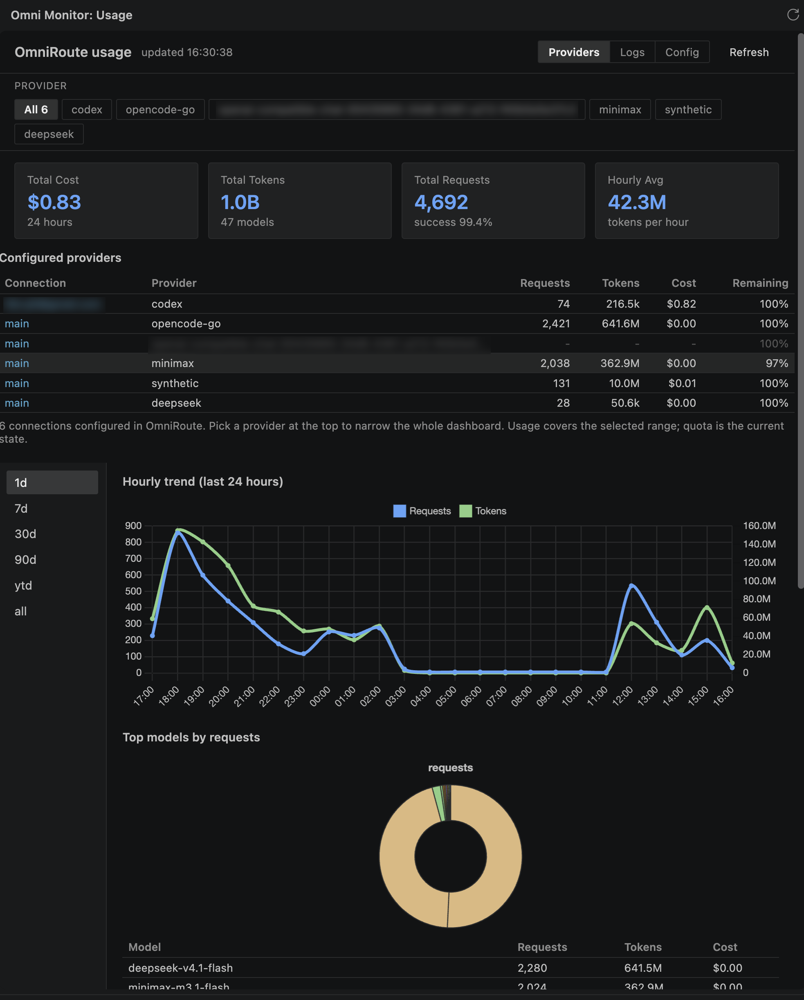
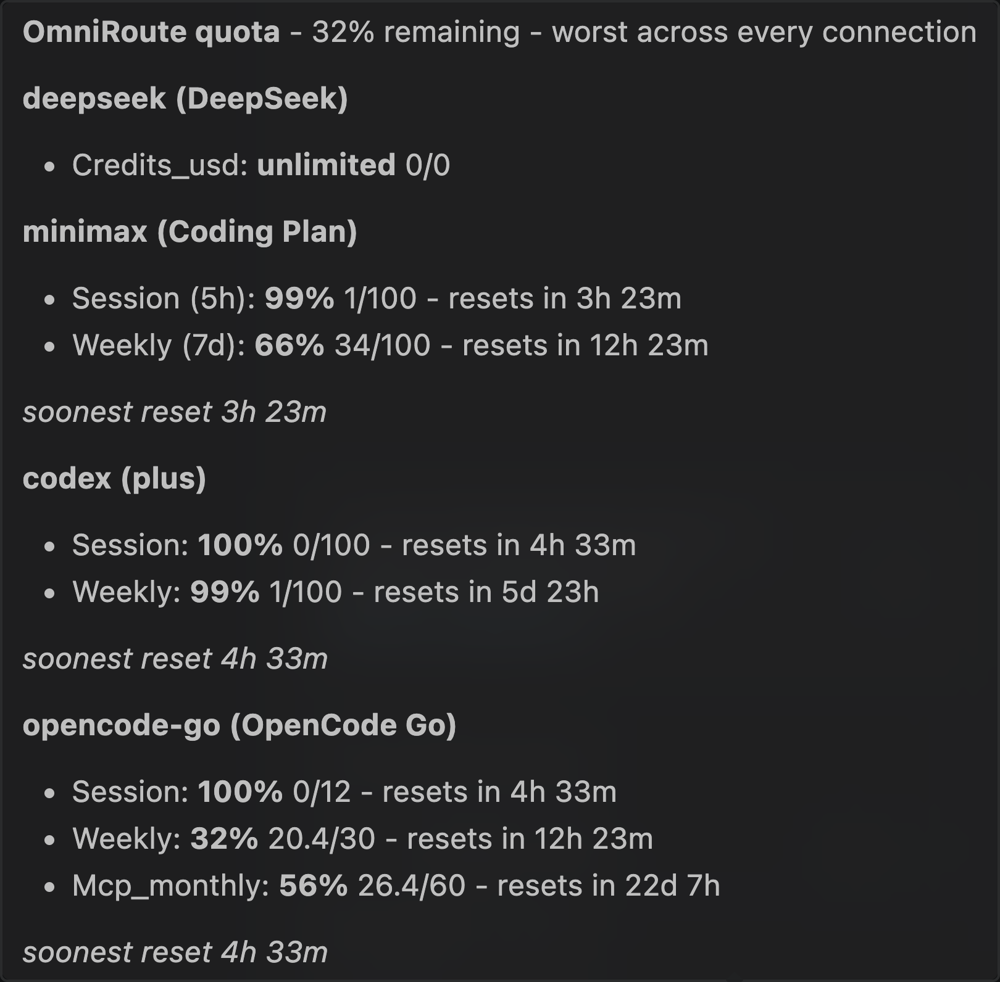
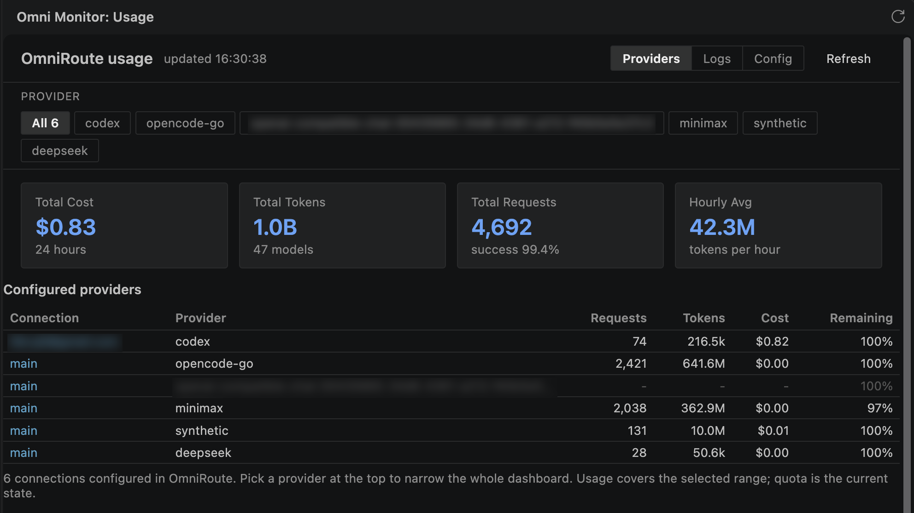
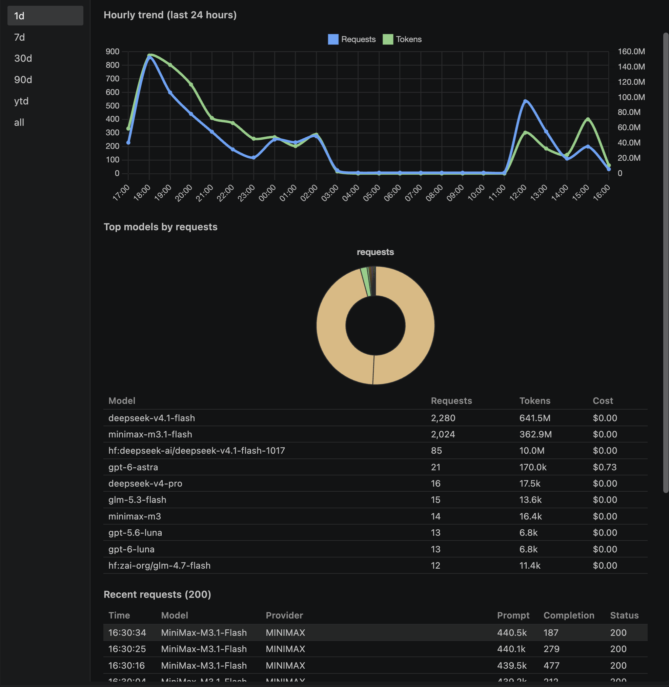
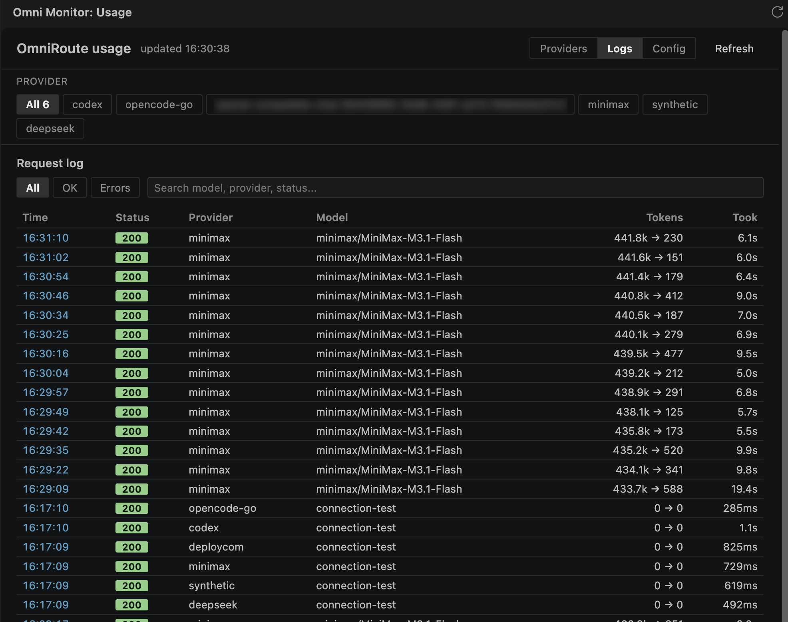
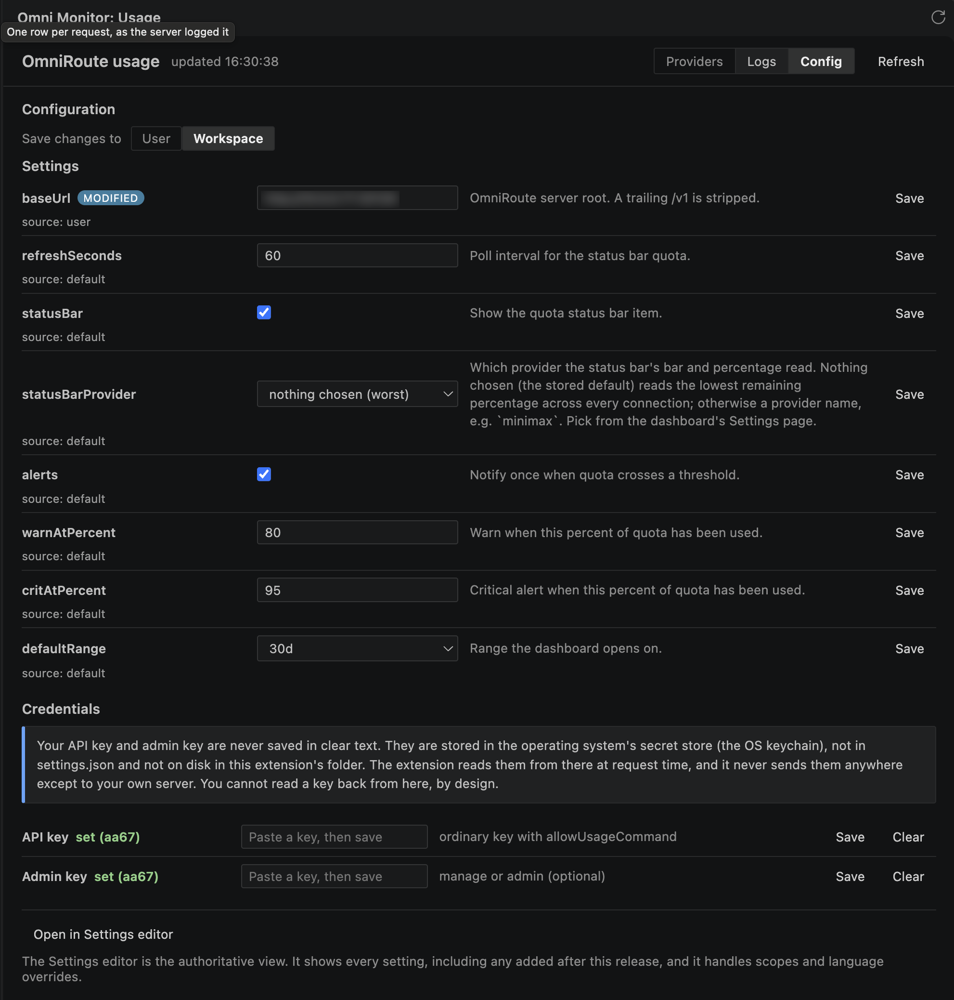

# Omni Monitor — API Quota Dashboard

Watch your [OmniRoute](https://github.com/cheaper-inference/OmniRoute) gateway
from inside VS Code. Quota left, tokens spent, and every request — without
leaving the editor.

**Omni Route** is a third-party extension. It is not affiliated with, nor
endorsed by, the OmniRoute project.

<p align="center">
  
</p>


---

## Why do you need it

OmniRoute puts one endpoint in front of every model your team uses. That is
good for reliability: when one provider rate-limits, the gateway routes around
it and your session keeps going. It is also good for your attention, because
everything now happens somewhere else.

- **You find out your quota ran out when the agent stops.** The failure is
  silent until the work is already blocked.
- **You find out what you spent when the invoice arrives.** Weeks after the
  request that cost it.
- **You find out which model is burning the budget when someone asks in a
  standup.** And "I will look into it" is not an answer.

OmniRoute's own dashboard has all of this — in a browser tab, on another
screen, in a window you have to remember to open and keep logging into.

This extension puts the same information where you already are: in the status
bar you are looking at, and in a panel one click away in the Activity Bar.

- **It is a monitor, not a model provider.** It contributes no chat provider and
  nothing to the Copilot model picker.
- **It coexists with what you already use.** If you serve models through
  OmniRoute with another extension, this one changes nothing about how your
  requests are routed.
- **It reads the same data the dashboard shows.** Same source, same numbers —
  just in the window you are already working in.


---

## What you get

### A quota bar in your status bar
<p align="center">
  
</p>


The bar shows how much quota is left, drawn as ten segments — solid for what
remains, outlined for what is spent — with the same number beside it. It
reads the lowest remaining percentage across every connection by default, so
one exhausted account turns the bar yellow before it surprises you.

Pick a single provider in the settings if you would rather track one account
than the worst case.

Hover the bar for the detail: what each connection reports, how much of each
window is used, when each one resets, and what your own key has spent against
its daily and weekly limits.

<p align="center">
  
</p>

### A usage dashboard in the Activity Bar


One panel over the same data:

- **Summary cards** — cost, tokens, requests with success rate, and daily average
- **Daily trend** — or 24 hourly buckets on the `1d` range, built from the
  per-request log because the server only aggregates by calendar date
- **Top models** — a donut and a breakdown table, so you can see which model
  is eating the budget
- **Quota by connection** — who has how much left, and when it resets
- **Request log** — one row per request: time, status, provider, model, tokens
  in → out, and how long it took. Click a timestamp to open the detail behind
  that call: the model that was actually served, the account and API key it
  used, the path, the cache source, the combo, and any error. Filter by
  provider, by `All` / `OK` / `Errors`, or search by model, provider, or
  status

<p align="center">
  
</p>

<p align="center">
  
</p>

The **Logs** view:

Filter to a single provider and every section narrows: the cards, the trend,
the model ranking, and the request log. That is the fastest way to answer "is
it this account?"

- **One row per request.** Every call the gateway logged, newest first: the
  timestamp, the status code, which connection served it, which model was asked
  for, the tokens that went in and came out, and how long it took.
- **Click a timestamp for the detail.** The model that was actually served
  versus the one that was requested, the account and API key behind it, the path
  called, the cache source, the combo it went through, and any error.
- **Filter it down.** The `All` / `OK` / `Errors` chips and the search box cut
  the list; the provider bar above narrows it to a single account.
That is the difference between "the bill went up" and knowing which request did
it.

<p align="center">
  
</p>


Everything uses VS Code variables, so the panel follows your config
instead of fighting it.

<p align="center">
  
</p>


---

## Can you trust it?

A reasonable question for something that reads your API usage. Here is what the
code actually does, not what it promises.

- **It only reads.** The extension makes three kinds of request, and every one
  is a `GET`: the self-service usage endpoint, the management analytics
  endpoints, and a framing probe before it opens the server's dashboard in a tab.
  There is no `POST`, `PUT`, `DELETE`, or `PATCH` anywhere in the source, so it
  cannot change your gateway configuration and cannot route a model call.
- **It registers no model provider.** The packaged extension is asserted during
  build to contain no `languageModelChatProviders` and no chat participants. If
  your Copilot model picker does not change when you install this, that is the
  assertion holding.
- **Your keys stay on your machine.** Both keys live in the OS keychain, through
  VS Code's `SecretStorage`. Neither ever goes into `settings.json`, and neither
  appears on a command line. The dashboard panel cannot read them — it asks the
  extension host, which answers with display values only.
- **Nothing leaves your setup.** There is no telemetry and no crash reporting.
  The extension sends nothing to the publisher. Every request goes to the
  OmniRoute server you configure, and nowhere else.
- **Least privilege, split.** The API key you need for the status bar is an
  ordinary key with the `allowUsageCommand` scope. The dashboard's admin key is
  optional and separate, and it only unlocks the dashboard. Give the admin key
  only if you want the dashboard.
- **MIT licensed, and the source is public.**
  [github.com/bruj0/omni-monitor](https://github.com/bruj0/omni-monitor) — read
  it, fork it, report an issue.

---

## Install

From the VS Code Marketplace, search for **Omni Monitor — API Quota Dashboard**,
or run:

```bash
code --install-extension bruj0.omni-monitor
```

It is also on [Open VSX](https://open-vsx.org/extension/bruj0/omni-monitor), so
it works on Cursor, Windsurf, VSCodium, Theia, and code-server.

Free and MIT licensed. No account, no subscription, no telemetry.

## Set it up

Two commands, both of which store the key in the OS keychain:

| Command | What it unlocks | Scope needed |
|---|---|---|
| `Omni Monitor: Set API Key` | the status bar quota | an ordinary key with `allowUsageCommand` |
| `Omni Monitor: Set Admin Key` | the dashboard | `manage` or `admin` |

The admin key is **optional**. Without it the status bar still works and the
dashboard shows a setup prompt.

Then point the extension at your gateway:

```json
{ "omniMonitor.baseUrl": "http://your-omni-route-host:20128" }
```

A trailing `/v1` is stripped for you.

### Enabling usage on your key

The status bar reads OmniRoute's self-service `om-usage` endpoint, which is
gated per key by `allowUsageCommand` and is **off by default**. Turn it on in
OmniRoute's API-key manager. Until you do, the extension says so instead of
showing an error.

## Settings

| Setting | Default | What it does |
|---|---|---|
| `omniMonitor.baseUrl` | `http://localhost:20128` | your OmniRoute server |
| `omniMonitor.refreshSeconds` | `60` | how often it polls |
| `omniMonitor.statusBar` | `true` | show the status bar item |
| `omniMonitor.alerts` | `true` | notify on threshold crossings |
| `omniMonitor.warnAtPercent` | `80` | warn when 80% is used |
| `omniMonitor.critAtPercent` | `95` | critical when 95% is used |
| `omniMonitor.statusBarProvider` | `worst` | which provider the bar reads |
| `omniMonitor.defaultRange` | `30d` | the dashboard's initial range |

## Privacy

The extension sends nothing to the publisher. There is no telemetry and no
crash reporting. Your keys live in the OS keychain, and every request goes to
the server you configure. See [PRIVACY.md](./PRIVACY.md).

## Support

Open an issue on
[GitHub](https://github.com/bruj0/omni-monitor/issues). See
[SUPPORT.md](./SUPPORT.md) for what to include, and for the known issues that
account for most reports.

## Building from source

```bash
npm install
npm run build       # tsc (type-check + host) + esbuild bundle
npm test            # tests over src/core/
npm run typecheck
npx vsce package    # -> omni-monitor-0.1.2.vsix
```

The extension host must be CommonJS, which VS Code requires, while a webview
bundle must be an IIFE with chart.js inlined. Both build steps are required;
running only `tsc -p ./` leaves the dashboard missing at runtime with no
error.

`src/core/` must never import `vscode`. That is what makes the percentage
arithmetic and the wire parsers testable without an editor.

## License

MIT. See [LICENSE](./LICENSE).

## Credits

Framing probe adapted from
[OmniCopilot](https://github.com/diegosouzapw/OmniCopilot) (MIT). Dashboard
layout and interaction patterns read from
[GCMP](https://github.com/vicanent/gcmp)'s `usagesView` and `multiDayView`.
